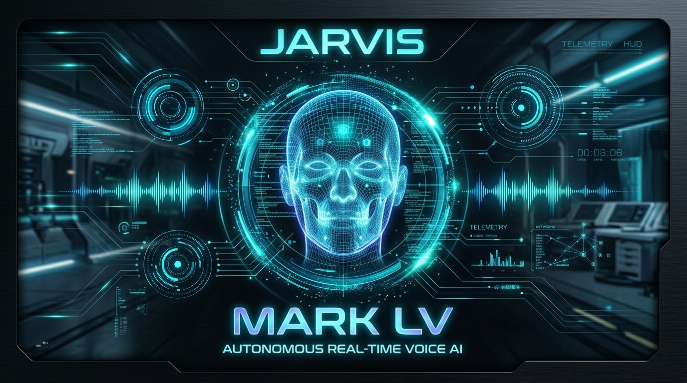
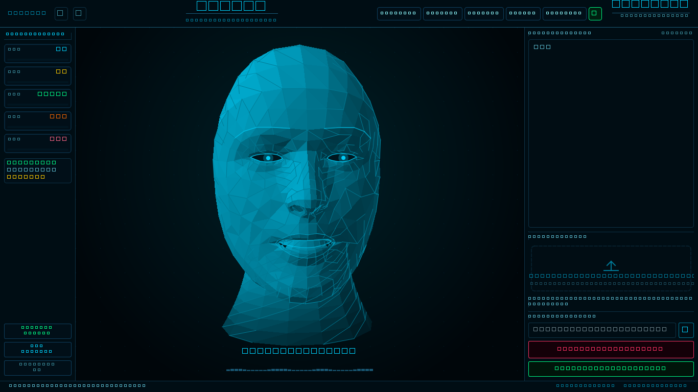
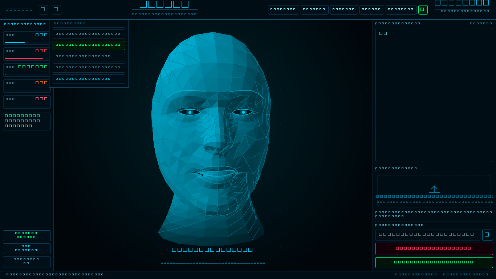
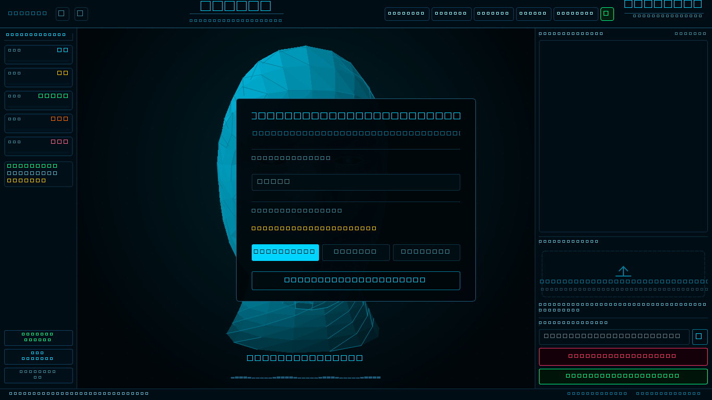
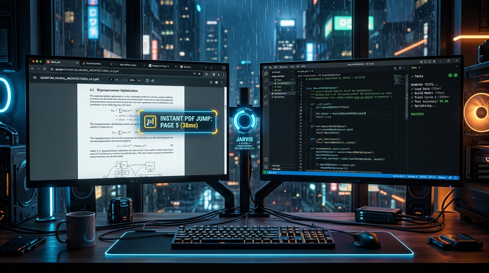
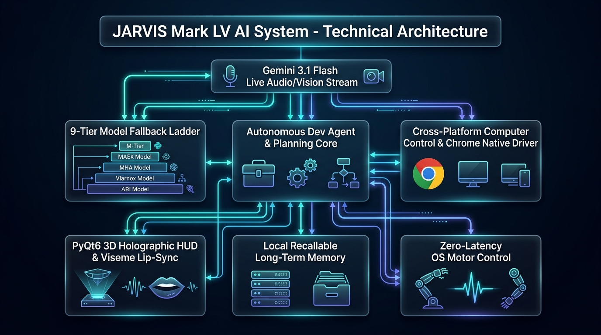
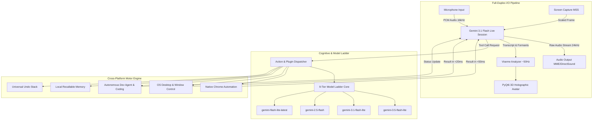

<div align="center">

# ⚙️ MARK LV (55)
### Autonomous Cross-Platform Personal Voice AI & Desktop Automation Engine
**Developed by Yash Surve ([@YashSurve2006](https://github.com/YashSurve2006)) — Powered by Google Gemini Live API**

[](https://github.com/YashSurve2006)
[](https://github.com/YashSurve2006)
[](https://www.python.org/)
[](https://github.com/YashSurve2006/Mark-LV)
[](https://ai.google.dev/)
[](https://creativecommons.org/licenses/by-nc/4.0/)

<br/>



<br/>

> 🎙️ **A real-time voice AI that can hear, see, speak, and autonomously operate your computer with sub-50ms native reflexes.** Zero subscription fees, zero cloud lock-in, and total digital autonomy.

[⚡ Quick Start](#-quick-start) • [🖥️ Live UI Showcase](#️-live-interface--actual-screenshots) • [🌐 Chrome & OS Control](#-autonomous-chrome--computer-control) • [📨 WhatsApp Engine](#-whatsapp--desktop-messaging) • [💼 LinkedIn Career Agent](#-linkedin--networking-domain-career-agent) • [🏗️ Architecture](#️-system-architecture) • [🔧 Setup & Run Guide](#-step-by-step-setup-and-run-guide) • [👤 Developer](#-developer--community)

</div>

---

## 📑 Table of Contents

- [✨ Overview](#-overview)
- [🖥️ Live Interface & Actual Screenshots](#️-live-interface--actual-screenshots)
- [🌐 Autonomous Chrome & Computer Control](#-autonomous-chrome--computer-control)
- [📨 WhatsApp & Desktop Messaging](#-whatsapp--desktop-messaging)
- [💼 LinkedIn & Networking Domain Career Agent](#-linkedin--networking-domain-career-agent)
- [🏗️ System Architecture](#️-system-architecture)
- [🚀 Core Capabilities](#-core-capabilities)
- [🗣️ Voice Commands Cheatsheet](#️-voice-commands-cheatsheet)
- [🆕 What's New in Mark LV](#-whats-new-in-mark-lv)
- [⚡ Quick Start](#-quick-start)
- [🔧 Step-by-Step Setup and Run Guide](#-step-by-step-setup-and-run-guide)
  - [1. Prerequisites](#1-prerequisites)
  - [2. Automated Setup (Recommended)](#2-automated-setup-recommended)
  - [3. Manual Setup](#3-manual-installation)
  - [4. Platform-Specific Setup](#4-platform-specific-configuration)
  - [5. How to Run](#5-how-to-run)
  - [6. API Keys & Configuration](#6-api-keys--configuration)
- [🎛️ Settings, Drawers & Customization](#️-settings-drawers--customization)
- [🗂️ Project Structure](#️-project-structure)
- [🔒 Security & Data Privacy](#-security--data-privacy)
- [🗺️ Version Roadmap](#️-version-roadmap)
- [👤 Developer & Community](#-developer--community)

---

## ✨ Overview

**Mark LV** bridges conversational intelligence with native computer autonomy. While typical voice assistants only output text or read search results, JARVIS Mark LV takes real physical control of your machine:

1. **Native Eyes & Ears:** Full-duplex bidirectional audio streaming via the **Gemini 3.1 Flash Live API**. Speaks and listens simultaneously with real-time viseme lip synchronization (~50 mouth shapes/sec) and zero cloud audio retention.
2. **Instant Native Motor Control:** Operating directly on your running Windows, macOS, or Linux workspace—manipulating open browser tabs, active applications, window stations, and system settings in sub-50ms.
3. **Autonomous Software Engineering:** Integrated autonomous coding engine (`dev_agent` and `code_helper`) that drafts architectures, writes multi-file apps, executes tests, and opens workspaces directly inside VS Code or Antigravity IDE.
4. **9-Tier Model Ladder with Resilient Failover:** Centralized model fallback cascade with intelligent cooldowns so API quota limits or network dropouts never freeze the assistant.

---

## 🖥️ Live Interface & Actual Screenshots

The HUD is built entirely with **PyQt6** and rendered in pure software. It requires **no dedicated GPU, no OpenGL drivers, and zero bulky game engine dependencies**.

### Actual Application Window

<div align="center">
  
  <p><i>Actual live running HUD screenshot — 3D Holographic Head Mesh, Reactive Audio Oscilloscope, Hardware Telemetry Gauges, and Real-Time Activity Log.</i></p>
</div>

<br/>

### Controls Drawer & Setup Overlay

<div align="center">
  <table width="100%">
    <tr>
      <td width="50%" align="center">
        
        <br/><b>🎛️ Controls Drawer (Daily Switches)</b>
        <br/><sub>Wake Word, Fullscreen, Morning Brief, Sleep, Push-to-Talk</sub>
      </td>
      <td width="50%" align="center">
        
        <br/><b>⚙️ Setup Drawer (System Configuration)</b>
        <br/><sub>Audio Device Probing, Remote QR Pairing, Auto-Start, Customization</sub>
      </td>
    </tr>
  </table>
</div>

### Interface Features

| Component | Technical Implementation |
|:---|:---|
| **🧑‍🎤 3D Holographic Avatar** | 3D human head geometry computed dynamically from the canonical MediaPipe face model (468 vertices). Features realistic blinking, saccadic eye movements, head nods on emphasized syllables, and ~50Hz phonetic visemes. |
| **〰️ Reactive Waveform** | Real-time audio reactive oscilloscope beneath the avatar. Pulses with electric cyan amplitude while listening to your microphone and matches JARVIS's voice output during playback. |
| **📊 Hardware Telemetry Gauges** | Live circular telemetry meters tracking CPU load, core temperatures, GPU memory, RAM allocation, and network status in real time. |
| **📜 Live System Activity Log** | Transparent event stream detailing every tool call, motor execution, and latency in milliseconds. |
| **🎛️ Split Dual Drawers** | Fast drawer tabs: `⚙ SETUP` (remote access, auto-start, audio devices) and `🎛 CONTROLS` (wake word, HUD themes, fullscreen, sleep timers). |

---

## 🌐 Autonomous Chrome & Computer Control

JARVIS Mark LV works directly on your **active, logged-in Google Chrome browser** and workspace. It never opens an isolated, guest, or empty browser sandbox—all your Google accounts, extensions, tabs, and bookmarks remain active.

<div align="center">
  
</div>

### Key Computer & Browser Capabilities

- **⚡ Lightning-Fast PDF Page Jumper (<40ms):**
  - Instant in-document navigation (`Home` + sequential `PageDown`) that jumps directly to requested page numbers in under 40 milliseconds without screen flicker.
  - Zero-latency URL hash fragment injection (`#page=N`) with automated hotkey reload for large document jumps.
  - Natural relative scrolling (*"scroll down 3 pages"*, *"next page"*, *"scroll up 2 pages"*) with zero AI vision model latency.
- **🔍 Zero-Token Active Address & Page Reader:**
  - Reads active tab URLs and full-page text in under 100ms without consuming Gemini input tokens or screenshot bandwidth.
- **📑 Seamless Tab Navigation:**
  - Switch tabs instantly by name or keyword using native Chromium Quick Tab search (`Ctrl+Shift+A`).
  - Open new tabs, close tabs, duplicate tabs, reload (`Ctrl+F5`), and zoom.
- **💻 Autonomous Coding & Agent IDE Integration:**
  - Ask JARVIS: *"Build a weather FastAPI service in Python and test it"* $\rightarrow$ JARVIS triggers `dev_agent` to draft architecture, generate source files, run unit tests, and open the workspace in VS Code or Antigravity IDE.
- **🖱️ Motor & Desktop Grounding:**
  - Mouse clicks, smooth drag-and-drop, natural wheel scrolling (calibrated to Windows `WHEEL_DELTA` 120 units), window management (minimize, maximize, focus, list), and system settings.

---

## 📨 WhatsApp & Desktop Messaging

JARVIS Mark LV includes an intelligent, multi-tier messaging pipeline designed to operate directly with the **native Windows WhatsApp Desktop application** (`5319275A.WhatsAppDesktop` / UWP) with zero browser clutter and instantaneous execution:

<div align="center">
  <table width="100%">
    <tr>
      <td width="33%" align="center">
        <b>⚡ Tier 1: Protocol Deep-Link</b><br/>
        <code>whatsapp://send?phone=...&text=...</code><br/>
        <sub>Direct kernel protocol launch straight to recipient with zero search delay.</sub>
      </td>
      <td width="33%" align="center">
        <b>🖥️ Tier 2: Desktop UI Automation</b><br/>
        <code>Ctrl + N</code> new chat modal + clipboard injection.<br/>
        <sub>Searches contact address book & handles emojis and multi-line formatting safely.</sub>
      </td>
      <td width="33%" align="center">
        <b>🌐 Tier 3: Browser Web Fallback</b><br/>
        <code>web.whatsapp.com/send</code><br/>
        <sub>Seamless browser fallback if desktop app is temporarily unreachable.</sub>
      </td>
    </tr>
  </table>
</div>

### Key Messaging Capabilities

- **🚀 Native WhatsApp Desktop Priority:** Automatically launches and restores your installed Windows WhatsApp Desktop app from the background or system tray in $<10\text{ms}$ using in-process COM and `win32gui`.
- **👁️ Safe Review Drafting Mode (`mode="draft"`):** Ask JARVIS *"Draft a message to Alex"* $\rightarrow$ JARVIS opens the chat and types the message into the WhatsApp compose box **without pressing Send**, allowing you to visually review the message before dispatching.
- **⚡ Instant Dispatch Mode (`mode="send"`):** Ask JARVIS *"Send a WhatsApp to Mom saying I'm heading home"* $\rightarrow$ JARVIS resolves Mom's phone number from local memory, targets the chat, and sends the message automatically.
- **🧠 Persistent Contact & Relationship Recall:** Stores nicknames and phone numbers locally in `memory/long_term.json`. Say *"Save contact Alex with number +91 9876543210 as brother"*, and JARVIS will recall and use that number for all future voice commands.
- **🌐 International Number Normalization:** Automatically cleans phone strings (strips dashes, spaces, and leading zeros) and formats international country codes (e.g. `+91` India, `+1` US/Canada).
- **💬 Multi-Platform Dispatch:** Seamlessly routes messages across Telegram, Discord, Signal, Instagram Direct, and Facebook Messenger using the same unified `send_message` action.

---

## 💼 LinkedIn & Networking Domain Career Agent

JARVIS Mark LV features a dedicated **LinkedIn Career & Networking Growth Engine** specifically architected to expand your technical connections, engage with active **IT Recruiters and Hiring Managers**, and position you for high-impact roles across the **Networking & Infrastructure domain**:

- **Target Job Roles:** L1/L2/L3 System Administrator, Network Engineer, NOC Analyst, Infrastructure Support Specialist.
- **Core Technical Coverage:** Cisco Routing & Switching, VLANs, Subnetting, OSPF, BGP, IPsec/SSL VPNs, Wireshark, Windows Server 2022, Active Directory Domain Services (AD DS), Group Policy Objects (GPO), Linux (RHEL/Ubuntu), Fortinet/Palo Alto Firewalls, VMware ESXi, SLAs & ITIL.

<div align="center">
  <table width="100%">
    <tr>
      <td width="33%" align="center">
        <b>🤝 HR & Recruiter Connection Hunter</b><br/>
        Validates connection request notes strictly under <b>200 characters</b> (LinkedIn free limit) with 2-step follow-up sequences.
      </td>
      <td width="33%" align="center">
        <b>🔎 1-Click Recruiter Search Hub</b><br/>
        Direct Boolean search queries and URLs to find active HRs, Tech Recruiters & Hiring Managers hiring for Cisco, AD, and Linux.
      </td>
      <td width="33%" align="center">
        <b>🛡️ Zero-Dependency Humanizer</b><br/>
        Strips invisible Unicode markers, typography tells & 113 stock AI slop terms, scoring drafts against a 5-check panel.
      </td>
    </tr>
  </table>
</div>

### Key Career Capabilities

- **🔍 Recruiter & ATS Profile Audit:**
  - Audits your LinkedIn profile against what IT infrastructure recruiters search for.
  - Generates copy-ready **SEO headlines (220 chars max)**, **high-converting 'About' hooks**, and **quantified experience bullets** (e.g. *99.9% uptime*, *Wireshark latency diagnostics*, *AD GPO management*).
- **📨 Strict <200 Char Connection Notes:**
  - Avoids the dreaded LinkedIn character cutoff. Crafts 3 targeted invite styles (Recruiter Focus, Tech Stack Focus, Hiring Manager Focus) strictly under 200 characters, plus automated 24-hour and 4-day follow-up messages.
- **✍️ Technical Networking & SysAdmin Posts:**
  - Turns raw troubleshooting stories into high-dwell technical posts using 21 proven hook formulas (`hooks.json`). Covers VLAN isolation, rogue DHCP tracking, Active Directory GPO recovery, and L1 vs L2 vs L3 root-cause triage.
- **🛡️ 5-Check AI Detection Panel (`detect.py`):**
  - Measures **Burstiness** (sentence length variation), **Specificity** (concrete technical markers per 100 words), **Slop Density** (lexicon hits against `slop.json`), **Fingerprint** (invisible tokens, em dashes, curly quotes), and **Voice** (contractions and structural tells).
- **📋 Zero-Friction Clipboard Integration:**
  - All drafted posts, connection notes, and audit reports are automatically copied to your Windows clipboard for instantaneous pasting into LinkedIn.

---

## 🏗️ System Architecture

JARVIS Mark LV separates voice processing, cognitive planning, and motor execution into decoupled, non-blocking pipelines:

<div align="center">
  
</div>



---

## 🚀 Core Capabilities

### Feature Matrix

| Feature | Category | Description |
|:---|:---|:---|
| **Holographic Avatar** | Visuals | 3D human head rendered via pure software `QPainter` geometry. Zero GPU requirements. |
| **Viseme Lip-Sync** | Speech | ~50 mouth shapes per second calculated from audio formants & transcripts. |
| **Push-to-Talk** | Audio | Hold **`Ctrl + Space`** globally on Windows to open mic; window-scoped on macOS/Linux. |
| **Wake Word Detection** | Voice | Offline **"Hey Jarvis"** wake-word detector with automated sleep after 2 min idle. |
| **Self-Echo Suppression** | Audio | Automatically cancels JARVIS's own audio feedback tail without muting your microphone. |
| **Instant PDF Navigation** | Automation | Jump to any page number or relative pages in Chrome/PDF reader in under 40ms. |
| **Real Chrome Integration** | Browser | Control running tabs, open URLs, search, and switch tabs without launching guest windows. |
| **Autonomous Dev Agent** | Coding | Build complete multi-file apps, run unit tests, and open IDEs directly from voice commands. |
| **9-Tier Model Ladder** | Resilience | Fallback cascade across 9 Gemini models with intelligent failure cooldowns. |
| **Recallable Memory** | Intelligence | Persistent long-term memory with fast local index search (`memory/long_term.json`). |
| **Universal Undo Stack** | Safety | Say *"Undo"* in any language to reverse file edits, folder moves, and settings changes. |
| **Hardware Confirmation** | Safety | Irreversible actions (Shutdown, Restart, WiFi Toggle) require physical UI confirmation. |
| **Video on the HUD** | Media | Play YouTube and local videos directly inside the HUD avatar viewport. |
| **Remote Dashboard** | Mobility | Mobile web dashboard accessible via QR code with self-signed TLS security. |
| **📨 WhatsApp Automation** | Messaging | Compose, draft, and send WhatsApp messages directly via protocol deep-link, desktop UWP app, or web. Includes contact memory & safe drafting mode. |
| **💼 LinkedIn Career Agent** | Career & Network | Automated HR connection notes (<200 chars), ATS profile auditor, recruiter search hub, and 5-check local humanizer for L1/L2/L3 SysAdmin & Network Engineers. |

---

## 🗣️ Voice Commands Cheatsheet

Speak naturally to JARVIS in English or your native language. The engine parses intent, selects the fastest motor skill, and executes in real time:

| Category | Example Voice Command | What JARVIS Executes |
|:---|:---|:---|
| **🌐 Chrome & Documents** | *"Scroll down to page 7 in this PDF"* | Sub-40ms native motor jump straight to page 7 without re-rendering delays. |
| | *"Switch to my GitHub pull request tab"* | Matches open tab titles via Chromium Quick Tabs (`Ctrl+Shift+A`). |
| | *"Read what this webpage says"* | Zero-token DOM inspection extracting visible page content in <100ms. |
| **💼 LinkedIn & HR Networking** | *"Connect to my LinkedIn"* | Verifies session and opens LinkedIn in your primary browser. |
| | *"Analyze my LinkedIn for Network Engineer and SysAdmin jobs"* | Audits profile, flags keyword gaps, and copies optimized headline & about section. |
| | *"Write a connection note for an HR at Cisco for a Network Engineer role"* | Generates 3 notes (<200 chars) + 2 follow-ups ready on clipboard. |
| | *"Find recruiters hiring Network Engineers"* | Generates direct boolean queries and opens live recruiter search feed. |
| | *"Write a networking post about Wireshark and DHCP snooping"* | Drafts technical post, cleans AI tells, scores on 5-check panel, and copies to clipboard. |
| | *"Humanize this draft and copy it to my clipboard"* | Strips invisible tokens and AI slop, scoring against the detection panel. |
| **📨 WhatsApp Automation** | *"Send a WhatsApp to Mom saying I'm on my way"* | Auto-resolves Mom's phone number and sends via WhatsApp Desktop app. |
| | *"Draft a WhatsApp message to Alex about lunch"* | Stages draft in WhatsApp compose box for visual review before sending. |
| | *"Save contact Rahul with number +91 98765 43210"* | Persists Rahul's details into `memory/long_term.json`. |
| **💻 Autonomous Coding** | *"Build a weather FastAPI service in Python and test it"* | Triggers `dev_agent` to plan architecture, write files, run tests, and open IDE. |
| | *"Write a test script for my database model and run it"* | Triggers `code_helper` to write unit tests, verify exit codes, and report results. |
| | *"Open this project in VS Code"* | Launches and focuses your IDE on the current project directory. |
| **📺 In-HUD Media** | *"Play Interstellar main theme on the HUD"* | Switches avatar to synchronized video player with automatic mic auto-ducking. |
| | *"Pause playback"* / *"Volume up to 75%"* | Adjusts media state or system sound output levels natively. |
| **🧠 Memory & Recall** | *"Remember that my primary IDE is Antigravity"* | Silently registers preference into persistent long-term storage. |
| | *"What are my active projects right now?"* | Reads your stored goals and active projects from long-term memory. |
| **🛡️ Safety & System** | *"Undo that"* | Automatically rolls back the last file move, deletion, or settings change. |
| | *"Turn off Wi-Fi"* / *"Restart the system"* | Displays a hardware confirmation banner on the HUD for physical click verification. |

---

## 🆕 What's New in Mark LV

- 💼 **LinkedIn & Networking Career Agent:** Dedicated career growth engine for Network Engineers and L1/L2/L3 System Administrators. Features strict <200 character HR connection notes, 1-click recruiter search hubs, ATS profile auditing, and zero-dependency local humanizing.
- 📺 **HUD Video Player:** Replaces avatar viewport on-demand for YouTube or local media with dual-stream synchronization and smart microphone auto-ducking.
- 📨 **Advanced WhatsApp Messaging Engine:** Deep-link protocol, Windows Desktop/UWP UI automation, contact and relationship resolution from memory, and safe review drafting mode.
- 🪜 **Unified 9-Tier Model Ladder:** Centralized fallback in `core/gemini.py` with 5-minute quota cooldowns and 30-minute outage backoffs.
- ⚡ **Ultra-Fast PDF Page Navigation:** Sub-50ms page jumping via in-document motor control and instant hash reloading.
- 🎛️ **Split Drawer Interface:** Clean separation of system configurations (`SETUP`) from daily toggles (`CONTROLS`).
- 🎧 **Calibrated Audio Device Prober:** Selects optimal host APIs (DirectSound for input, MME for output) to eliminate silent audio drops.
- 🔗 **Session Resumption:** Automatically recovers live sessions across audio device switches and transient network hiccups.

---

## ⚡ Quick Start

```bash
# 1. Clone repository
git clone https://github.com/YashSurve2006/Mark-LV.git
cd Mark-LV

# 2. Automated setup (installs OS-specific packages & browser engines)
python setup.py

# 3. Launch JARVIS Mark LV
python main.py
```

> [!NOTE]
> On first launch, JARVIS will ask you for your free **Google Gemini API Key** and store it securely in `config/api_keys.json`.

---

## 🔧 Step-by-Step Setup and Run Guide

### 1. Prerequisites

- **Operating System:** Windows 10/11 (64-bit), macOS 12+ (Apple Silicon or Intel), or Linux (Ubuntu 22.04+, Fedora, Arch).
- **Python:** `3.11`, `3.12`, or `3.13` (Python 3.11 or 3.12 recommended).
- **Audio Hardware:** Working microphone and speakers / headphones.
- **Gemini API Key:** Get a free API key at [Google AI Studio](https://aistudio.google.com/app/apikey).

---

### 2. Automated Setup (Recommended)

Run the included OS-aware setup script:

```bash
python setup.py
```

`setup.py` automatically:
1. Validates your Python version (`>= 3.11`).
2. Filters and installs dependencies for your current OS using `sys_platform` markers.
3. Installs Chromium and Firefox Playwright automation binaries.
4. Verifies the integrity of the 3D face model (`core/face_model.obj`).

---

### 3. Manual Installation

If you prefer installing dependencies manually using `pip`:

```bash
# Upgrade pip
python -m pip install --upgrade pip

# Install dependencies
pip install -r requirements.txt

# Install Playwright browser engines
python -m playwright install chromium firefox
```

---

### 4. Platform-Specific Configuration

<details>
<summary><b>🪟 Windows Setup Notes</b></summary>

- **Global Hotkey:** `Ctrl + Space` push-to-talk works globally across all games and fullscreen windows.
- **Python Win32 Postinstall:** If `win32com` prompts for registration, run:
  ```bash
  python Scripts/pywin32_postinstall.py -install
  ```
- **Windows Terminal UTF-8:** Recommended to use Windows Terminal with UTF-8 encoding enabled.
</details>

<details>
<summary><b>🍎 macOS Setup Notes</b></summary>

- **Accessibility Permissions:** Required for keyboard and mouse automation. Grant access under:
  *System Settings $\rightarrow$ Privacy & Security $\rightarrow$ Accessibility $\rightarrow$ Terminal / Python*.
- **Microphone & Screen Recording:** Grant Terminal/IDE permission to capture audio and screen when prompted.
- **Push-to-Talk:** Push-to-talk operates within window scope on macOS.
</details>

<details>
<summary><b>🐧 Linux Setup Notes</b></summary>

- **Audio Subsystem:** Ensure `portaudio19-dev` and `pulseaudio` or `pipewire` headers are installed:
  ```bash
  sudo apt-get install portaudio19-dev libasound2-dev libpulse-dev
  ```
- **X11 / Wayland:** For full mouse and keyboard automation on Wayland, ensure XWayland compatibility or use an X11 desktop session.
</details>

---

### 5. How to Run

Launch JARVIS using the primary runner:

```bash
python main.py
```

Or launch the standalone UI window:

```bash
python ui.py
```

---

### 6. API Keys & Configuration

Configuration is managed locally via `config/api_keys.json` (strictly protected by `.gitignore` so your personal keys are never exposed).

A clean template is provided in [`config/api_keys.json.example`](file:///d:/JARVIS/Mark-LV/config/api_keys.json.example):

```json
{
  "gemini_api_key": "YOUR_GEMINI_API_KEY",
  "github_token": "YOUR_OPTIONAL_GITHUB_PAT",
  "assistant_name": "Jarvis",
  "os_system": "windows"
}
```

| Key | Required? | Source / Purpose |
|:---|:---|:---|
| `gemini_api_key` | **Yes** | Free from [Google AI Studio](https://aistudio.google.com/app/apikey). Powers the Gemini Live audio session & 9-tier Model Ladder. |
| `github_token` | Optional | Personal Access Token from [GitHub Developer Settings](https://github.com/settings/tokens). Enables `github_manager` repo, PR, and commit automation. |
| `assistant_name` | Optional | Customizes assistant's voice trigger name (default: `"Jarvis"`). |
| `os_system` | Optional | Host OS identifier (`"windows"`, `"mac"`, `"linux"`). Auto-detected if omitted. |

---

## 🎛️ Settings, Drawers & Customization

| Action | How to Trigger | Description |
|:---|:---|:---|
| **Push-to-Talk** | Hold **`Ctrl + Space`** | Instantly opens microphone; release to stop streaming audio. |
| **Wake Word** | Say *"Hey Jarvis"* | Activates assistant from sleep (toggle in `CONTROLS` drawer). |
| **Send WhatsApp** | Say *"Send a WhatsApp to Mom: I'm on my way"* | Dispatches directly via native WhatsApp Desktop with auto-resolved contact number. |
| **Draft WhatsApp** | Say *"Draft a WhatsApp to Alex about lunch"* | Stages message in WhatsApp Desktop compose box without sending for your visual review. |
| **Save Contact** | Say *"Save contact Alex with number +91..."* | Persists contact details & relationship aliases in long-term recall memory. |
| **Instant PDF Jump** | Say *"Scroll to page 5"* | Instantly jumps to page 5 in Chrome PDF reader (<40ms). |
| **Relative Page Scroll** | Say *"Scroll down 3 pages"* | Smoothly scrolls down 3 pages using `PageDown`. |
| **Custom Theme** | Open `SETUP` $\rightarrow$ **Hue Wheel** | Live recolors entire HUD and 3D avatar wireframe. |
| **Voice Selection** | Open `SETUP` $\rightarrow$ **Voices** | Switch live between 5 native Gemini voices (*Puck, Charon, Kore, Fenrir, Aoede*). |
| **Undo Last Action** | Say *"Undo that"* | Reverses file operations, moves, and computer settings. |
| **Remote Dashboard** | Open `SETUP` $\rightarrow$ **Remote** | Scan QR code on your phone to open mobile control HUD. |

---

## 🗂️ Project Structure

```
Mark-LV/
├── main.py                     # Primary runtime engine — Gemini Live loop, audio stream & tool dispatch
├── ui.py                       # PyQt6 HUD — 3D avatar canvas, waveform visualizer & dual drawers
├── setup.py                    # OS-aware automated environment & dependency installer
├── requirements.txt            # Python dependencies with platform-specific markers
├── LICENSE                     # Creative Commons Attribution-NonCommercial 4.0 International
├── readme.md                   # Complete architectural documentation & user manual
├── .gitignore                  # Security-first ignore rules guarding keys, certs & caches
│
├── assets/                     # High-resolution architectural and live UI assets
│   ├── actual_ui_screenshot.png       # Live running HUD screenshot (Avatar, Waveform, Telemetry)
│   ├── actual_controls_drawer.png     # Live running HUD screenshot (Daily Controls Drawer)
│   ├── actual_setup_overlay.png       # Live running HUD screenshot (System Setup Drawer)
│   ├── jarvis_hero_banner.png         # Official high-resolution header banner
│   ├── jarvis_architecture_diagram.png# Full-duplex audio/vision & motor architecture diagram
│   ├── jarvis_chrome_control.png      # Autonomous Chrome & PDF navigation showcase
│   └── jarvis_hud_ui.png              # Holographic HUD interface conceptual layout
│
├── actions/                    # Bundled Computer Skills (Auto-discovered dynamically at boot)
│   ├── computer_control.py     # Native mouse, keyboard, Chrome tabs & <40ms PDF navigation
│   ├── computer_settings.py    # Volume, brightness, WiFi, power states & fast page scrolling
│   ├── browser_control.py      # Playwright browser automation, DOM scraping & web forms
│   ├── screen_processor.py     # Real-time screen capture (MSS), multi-monitor & vision grounding
│   ├── dev_agent.py            # Autonomous software engineer (architecture, code, test, deploy)
│   ├── code_helper.py          # Quick script generation, test runner & IDE workspace launcher
│   ├── smart_automation.py     # Multi-step reasoning planner with iterative visual loop feedback
│   ├── file_controller.py      # Local file manager, search & automated desktop/downloads cleanup
│   ├── file_processor.py       # Document parser & summarizer for PDFs, text & markdown
│   ├── system_monitor.py       # Live hardware telemetry collector (CPU, GPU, RAM, temps, disk)
│   ├── github_manager.py       # GitHub REST API integration (repos, PRs, issues, commits)
│   ├── open_app.py             # Desktop application launcher & cross-platform process focus
│   ├── desktop.py              # Window geometry management & virtual desktop workspace switcher
│   ├── web_search.py           # Dual-pipeline search (Gemini Grounding + DuckDuckGo fallback)
│   ├── youtube_video.py        # YouTube search, streaming playback & media control
│   ├── video_player.py         # In-HUD synchronized video playback with audio ducking
│   ├── weather_report.py       # Real-time weather forecasts, meteorological data & alerts
│   ├── flight_finder.py        # Live flight tracker, route search & arrival status
│   ├── reminder.py             # Natural language alarm scheduler & desktop notifications
│   ├── send_message.py         # Outbound messaging dispatcher (WhatsApp multi-tier, Telegram, Discord)
│   ├── workflow.py             # Multi-command chained workflows & custom macro sequences
│   ├── proactive.py            # Ambient proactive intelligence & contextual user prompts
│   ├── game_updater.py         # Game library update monitor & patch status verifier
│   └── background_monitor.py   # Asynchronous background observer for clipboard & system health
│
├── core/                       # Core Runtime Subsystems & AI Engines
│   ├── gemini.py               # 9-tier Model Ladder with intelligent timeout & quota backoff
│   ├── llm_client.py           # Universal LLM abstraction interface & REST fallback handler
│   ├── coder_engine.py         # Deep coding LLM pipeline for software generation & repairs
│   ├── prompt.txt              # System prompt, personality grounding & motor execution schema
│   ├── action_loader.py        # Dynamic auto-discovery & schema reflection for actions/
│   ├── plugin_loader.py        # Modular lifecycle manager for user-contributed plugins
│   ├── avatar.py               # Pure-software 3D wireframe avatar renderer powered by QPainter
│   ├── avatar_mesh.py          # 3D head geometry mathematics, projection & rotational matrices
│   ├── face_model.obj          # Canonical MediaPipe 468-vertex 3D facial topology geometry
│   ├── viseme.py               # Phonetic transcript analyzer producing ~50Hz mouth visemes
│   ├── echo.py                 # Real-time acoustic self-echo cancellation & bleed suppression
│   ├── wake_word.py            # Offline lightweight wake-word detector ("Hey Jarvis")
│   ├── hotkey.py               # Cross-platform global keyboard hook (Ctrl+Space push-to-talk)
│   ├── undo.py                 # Universal undo journal engine to revert files & settings
│   ├── confirm.py              # Hardware confirmation token gate protecting high-risk actions
│   ├── audio_devices.py        # Latency prober & device enumerator (DirectSound / MME)
│   ├── installer.py            # Runtime dependency verifier & dynamic module helper
│   ├── stt.py                  # Offline / online speech-to-text transcription fallback
│   └── tts.py                  # Text-to-speech synthesis & audio output playback stream
├── dashboard/                  # Mobile & Web Remote Companion Subsystem
│   ├── server.py               # Local HTTPS/WebSocket server with self-signed TLS & token auth
│   └── static/                 # Companion web interface frontend assets
│       ├── app.html            # Single-page responsive mobile control HUD & remote microphone
│       ├── login.html          # Secure PIN / password authentication gate
│       └── crypto-js.min.js    # Client-side cryptographic hashing & secure token verification
│
├── memory/                     # Memory, State & Configuration Management
│   ├── memory_manager.py       # Long-term episodic memory engine with keyword indexing
│   ├── config_manager.py       # Thread-safe atomic JSON configuration reader/writer
│   └── long_term.json          # Persistent recallable facts, preferences & project history
│
├── plugins/                    # Drop-in Extensible Plugin Ecosystem
│   ├── _template.py            # Boilerplate starter template for custom user plugins
│   ├── _whatsapp_core.py       # Core multi-tier WhatsApp driver (Protocol, Desktop, Web)
│   ├── whatsapp.py             # Dedicated WhatsApp plugin (compose, draft, send, contacts)
│   ├── doc_writer.py           # Technical documentation, LaTeX & Markdown generator plugin
│   ├── pdf_tutor.py            # Interactive PDF reading, educational analyzer & quiz tutor
│   ├── linkedin_agent.py       # LinkedIn growth agent (post generation, HR outreach, profile audit)
│   └── linkedin/               # LinkedIn intelligence engine
│       ├── engine.py           # Core orchestrator for hooks, humanizer, detector & HR hunter
│       ├── humanize.py         # 3-pass local humanizer (invisible chars, typography, slop replacement)
│       ├── detect.py           # 5-check local AI detection panel (Burstiness, Specificity, Slop, Fingerprint, Voice)
│       ├── hooks.json          # 21 proven viral hook formulas
│       ├── rubric.json         # 12-point recruiter & profile evaluation rubric
│       └── slop.json           # 113 stock AI vocabulary definitions & replacements
│
├── .agents/skills/             # Universal Agent Skills for Antigravity & Claude
│   ├── li-post/                # Hook formula post generator skill
│   ├── li-human/               # AI fingerprint & slop stripping skill
│   ├── li-comment/             # Feed engagement & archetype commenting skill
│   ├── li-reply/               # Comment thread triage & reply generator skill
│   ├── li-profile/             # Profile audit & rewrite skill
│   ├── li-plan/                # Weekly calendar & target account planning skill
│   ├── li-carousel/            # Document post slide-by-slide copy skill
│   ├── li-repurpose/           # Long-form content repurposing skill
│   ├── li-dm/                  # <200 char connection invite note skill
│   ├── li-inbox/               # Inbound DM triage skill
│   └── li-audit/               # Post-mortem engagement & reach analytics skill
│
└── config/                     # Configuration Templates & Application Resources
    ├── api_keys.json.example   # Clean template for API keys (Gemini, GitHub, etc.)
    ├── linkedin_voice.md       # Tailored LinkedIn voice & tone profile for SysAdmin & Networking
    ├── jarvis.ico              # Native application icon
    └── certs/                  # Auto-generated self-signed TLS certificates for local HTTPS
```

### Subsystem Breakdown

| Subsystem | Primary Responsibility | Key Files |
|:---|:---|:---|
| **I/O & Speech Engine** | Full-duplex 16kHz audio capture, 24kHz playback, ~50Hz viseme calculation, self-echo cancellation. | `core/audio_devices.py`, `core/viseme.py`, `core/echo.py`, `core/wake_word.py` |
| **Cognitive Ladder** | 9-tier model fallback cascading across Gemini models with quota cooldowns and auto-resumption. | `core/gemini.py`, `core/llm_client.py`, `core/prompt.txt` |
| **3D Holographic HUD** | Pure-software 3D facial mesh rendering with zero GPU overhead, audio oscilloscope, telemetry gauges. | `ui.py`, `core/avatar.py`, `core/avatar_mesh.py`, `core/face_model.obj` |
| **Motor & Browser Engine** | Sub-50ms native mouse, keyboard, active Chrome tab interaction, instant PDF jumping, settings control. | `actions/computer_control.py`, `actions/computer_settings.py`, `actions/browser_control.py` |
| **Messaging & WhatsApp** | Multi-tier WhatsApp automation (protocol, desktop UWP, web), contact memory, safe drafting mode. | `actions/send_message.py`, `plugins/_whatsapp_core.py`, `plugins/whatsapp.py` |
| **💼 LinkedIn & Career Agent** | Recruiter connection outreach (<200 chars), ATS profile auditor, recruiter search hub, and 5-check humanizer. | `plugins/linkedin_agent.py`, `plugins/linkedin/engine.py`, `config/linkedin_voice.md` |
| **Autonomous Dev Agent** | Multi-file codebase synthesis, unit test execution, and IDE workspace launching from voice commands. | `actions/dev_agent.py`, `actions/code_helper.py`, `core/coder_engine.py` |
| **Safety & Memory** | Universal undo journal, hardware confirmation gates, persistent local recallable memory. | `core/undo.py`, `core/confirm.py`, `memory/memory_manager.py` |
| **Remote Companion** | Encrypted mobile web dashboard accessible via QR code with self-signed TLS encryption. | `dashboard/server.py`, `dashboard/static/app.html` |

---

## 🔒 Security & Data Privacy

- **100% Local Execution:** All application logic, GUI rendering, memory stores, and computer control scripts execute locally on your machine.
- **Zero Account Tracking:** No telemetry, no background analytics, and no third-party servers.
- **Encrypted Local Storage:** API keys and local tokens are stored locally in `config/api_keys.json` (strictly ignored by `.gitignore`).
- **Physical Confirmation Gate:** Dangerous actions (rebooting, system shutdowns, and WiFi disconnection) cannot be autonomously confirmed by the AI—they require a physical click on the HUD confirmation banner.

---

## 🗺️ Version Roadmap

| Version | Milestone Features |
|:---|:---|
| **Mark LII** | Live theme customizer, audio device prober, recallable memory, undo engine. |
| **Mark LIII** | Offline "Hey Jarvis" wake word, Gemini 3.1 Flash Live migration, instant spoken acknowledgments. |
| **Mark LIV** | 3D Holographic avatar mesh, 50Hz viseme lip-sync, push-to-talk chord, self-echo guard. |
| **Mark LV** | **Current Release:** Native in-HUD video player, 9-tier model ladder, sub-50ms PDF jump, autonomous Chrome driver, split control drawers. |
| **Mark LVI+** | Full voice barge-in interrupt, local speech-to-text offline fallback, Obsidian vault syncing, home automation. |

---

## 👤 Developer & Community

Engineered with passion for personal AI autonomy by **Yash Surve**.

- 🌐 **GitHub Profile:** [@YashSurve2006](https://github.com/YashSurve2006)
- 📦 **Project Repository:** [https://github.com/YashSurve2006/Mark-LV](https://github.com/YashSurve2006/Mark-LV)
- 📧 **Email:** [yashsurve2019@gmail.com](mailto:yashsurve2019@gmail.com)

---

<div align="center">
  <b>⭐ Star the repository on GitHub to support the journey to Mark 100! ⭐</b>
</div>
